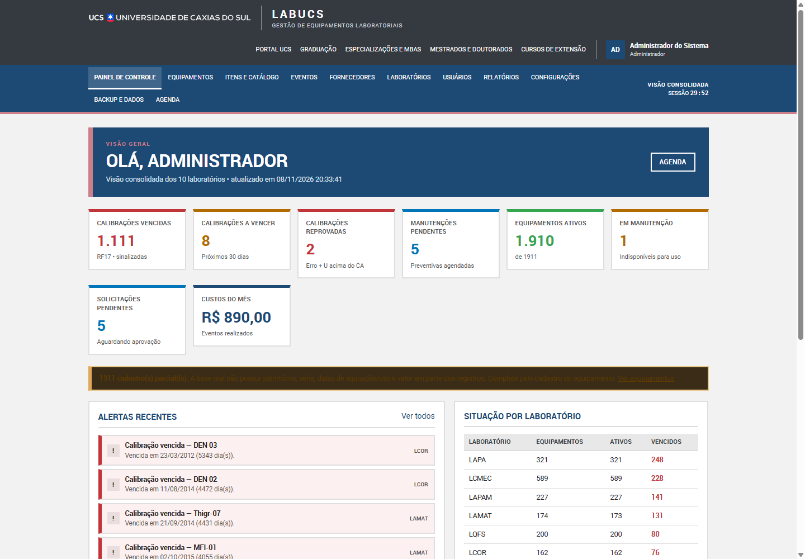
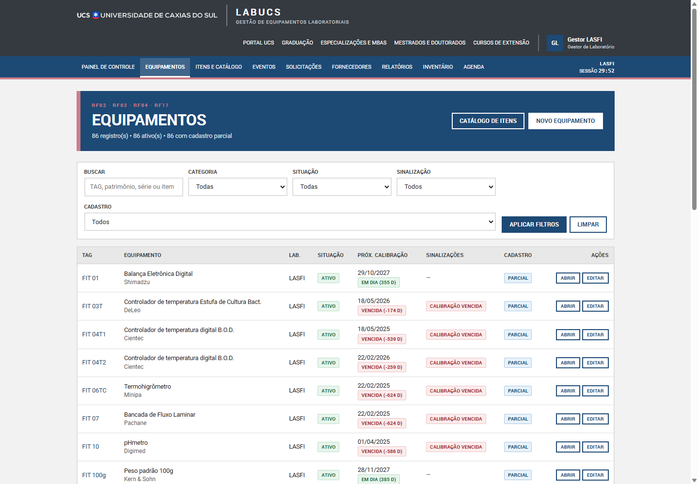
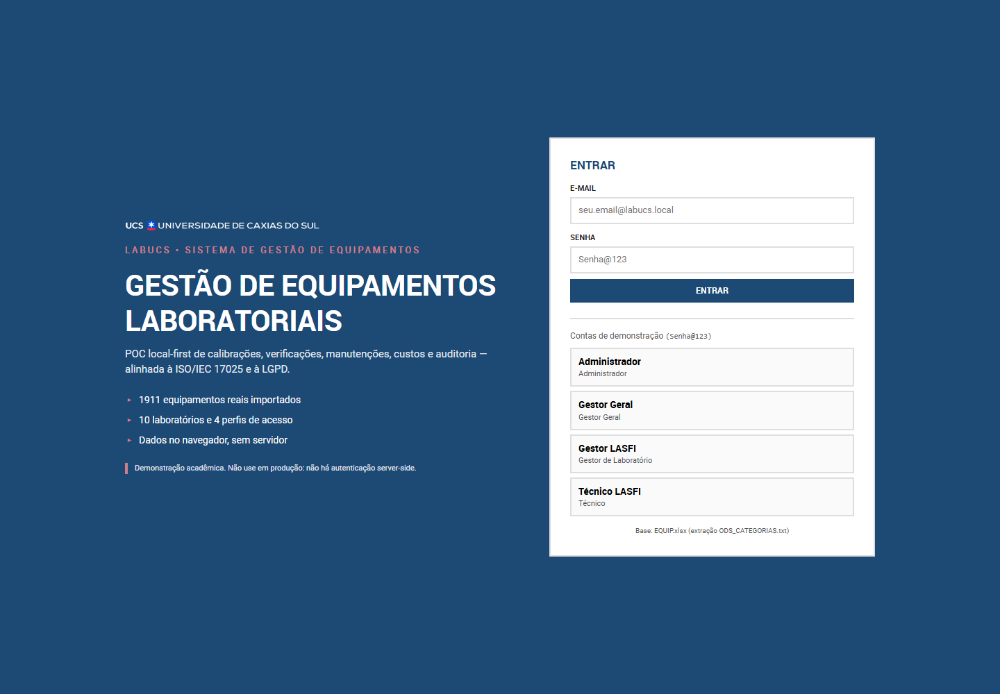

# LabUcs — Gestão de Equipamentos Laboratoriais

**POC acadêmica da UCS** para gestão de equipamentos, calibrações, verificações, manutenções, fornecedores e custos dos laboratórios. Frontend e backend separados, **100% estático**, compatível com **GitHub Pages**.

> **Não é produção.** Não há servidor, autenticação institucional, banco remoto ou SLA. Os dados ficam no navegador. O aviso está na interface e nos PDFs.



## Destaques

- **1.911 equipamentos reais** de 10 laboratórios, 823 itens/modelos e 1.726 calibrações registradas.
- **Todos os RF01–RF17** e os RNF01–RNF15 no escopo estático.
- Cálculo metrológico **`|erro| + U ≤ CA`**, com CA/periodicidade herdados do item ou especializados.
- Sinalizações do RF17 **sem bloqueio automático**.
- Relatórios compatíveis com os anexos atuais, com exportação **PDF, XLSX e CSV**.
- Identidade visual **institucional UCS**: Roboto, azul `#1d4975`, cinza `#343a40`, cantos retos e rodapé com logos oficiais.

## Arquitetura separada

```
src/
  shared/                constantes, erros, validação e formatação
  backend/               regras de negócio (não importa DOM)
    domain/              metrologia, prazos, permissões, LGPD
    application/         casos de uso em camadas
    infrastructure/      IndexedDB, sessão/PBKDF2, semente
    reports/             construtores + PDF/XLSX/CSV
    api/                 criarAplicacao()
  frontend/              interface UCS
    main.js, router.js, layout.js
    pages/               uma página por domínio
    components/          formulários, tabelas, opções e UI
    styles.css           identidade institucional
    assets/              logos oficiais e Roboto
data/                    base real importada
docs/                    documentação e matriz
contract/                tipagem TypeScript
tests/                   56 testes
```

O frontend conversa apenas com a fachada `criarAplicacao()` do backend. Ele não recalcula Erro+U, prazos, permissões ou relatórios. O contrato está em [contract/labucs.d.ts](contract/labucs.d.ts).

## Início rápido

Requisitos: Node.js 20+ apenas para servir/testar.

```bash
npm test       # 56 testes
npm run dev    # http://127.0.0.1:4173
```

Abra em janela anônima. A primeira carga importa a base real para o IndexedDB e cria as contas de demonstração.

### Contas

Senha: `Senha@123`

| Conta | Perfil |
| --- | --- |
| `admin@labucs.local` | Administrador |
| `gestor.geral@labucs.local` | Gestor Geral |
| `gestor.lasfi@labucs.local` | Gestor de Laboratório (LASFI) |
| `tecnico.lasfi@labucs.local` | Técnico (LASFI) |

Há gestor e técnico para as 10 siglas: `lasfi`, `lamec`, `lcmec`, `lmc`, `lamat`, `lapa`, `lcor`, `lapam`, `lbtec`, `lqfs`.

## Funcionalidades

- **Cadastros:** laboratórios, usuários/perfis, fornecedores, categorias/subcategorias, itens e equipamentos.
- **Metrologia:** calibração/verificação com certificado, erro, U, CA, fornecedor, custo e resultado.
- **Prazos:** próxima calibração/verificação, dias corridos, status vencido/a vencer/em dia.
- **RF17:** calibração vencida/reprovada, verificação vencida e periodicidade zero.
- **Manutenções:** preventiva recorrente e corretiva com estado de retorno.
- **Solicitações:** criação, aprovação/rejeição e segregação de funções.
- **Painel:** alertas de vencimento, manutenção e solicitações pendentes.
- **Relatórios:** inventário, situação, histórico, Anexos 1/2/4/5 e custos × receita.
- **Governança:** RBAC por laboratório, auditoria, backup diário/manual, exportação/importação JSON e LGPD.

## Identidade institucional

A interface segue o [portal da UCS](https://ucsvirtual.ucs.br/site/portalcurso/101/):

- fonte **Roboto** (arquivos locais);
- azul da área de Exatas **#1d4975** e secundária **#cc7e89**;
- cinza **#343a40** no topo e rodapé; fundos **#e8e8e8** e bordas **2px #dedede**;
- títulos e botões em caixa alta, cantos retos;
- logos oficiais UCS e FUCS em `src/frontend/assets/`.





## Base real

| Indicador | Valor |
| --- | ---: |
| Laboratórios | 10 |
| Equipamentos | 1.911 |
| Itens | 823 |
| Com calibração | 1.726 |
| Sem calibração | 185 |
| Usuários | 22 |
| Eventos importados | 1.735 |

Fontes: `EQUIP.xlsx` (extração textual), `FG 020` e `FG 006`. Importador reprodutível:

```bash
npm run importar
```

Campos ausentes na origem **não são inventados**: ficam nulos e aparecem como pendência. O CA é estimado por categoria e marcado para revisão. TAG é única por laboratório (a base real reutiliza TAGs entre labs).

## Testes

```bash
npm test
```

Cobrem domínio, serviços, RBAC, auditoria, persistência, base real, relatórios e exportações. O smoke de interface usa Chrome headless:

```bash
node scripts/inspecionar.js http://127.0.0.1:4173/ \
  --login=tecnico.lasfi@labucs.local --goto="#/equipamentos/1"
```

## Deploy

O workflow [.github/workflows/pages.yml](.github/workflows/pages.yml) testa, monta `_site` com `src/`, `data/`, `docs/` e `contract/`, e publica via GitHub Actions.

Passo a passo, caminhos relativos, IndexedDB e checklist: [docs/06-DEPLOY-GITHUB-PAGES.md](docs/06-DEPLOY-GITHUB-PAGES.md).

## Documentação

- [01 — Visão e arquitetura](docs/01-VISAO-E-ARQUITETURA.md)
- [02 — Modelo de dados](docs/02-MODELO-DE-DADOS.md)
- [03 — Regras de negócio](docs/03-REGRAS-DE-NEGOCIO.md)
- [04 — Contrato de serviços](docs/04-API-DE-SERVICOS.md)
- [05 — Validação e testes](docs/05-VALIDACAO-E-TESTES.md)
- [06 — Deploy no GitHub Pages](docs/06-DEPLOY-GITHUB-PAGES.md)
- [07 — Matriz de rastreabilidade](docs/07-MATRIZ-RASTREABILIDADE.md)
- [Relatório de importação](data/RELATORIO-IMPORTACAO.md)

## Limitações

| Limitação | Consequência |
| --- | --- |
| Site estático | Sem autenticação real, IP real ou concorrência entre dispositivos |
| Dados no navegador | Limpar o site apaga os dados; use backup/exportação |
| Base incompleta | Cadastros parciais e CA estimado |
| RNF06 | Disponibilidade delegada ao GitHub Pages |
| PDF | Sem assinatura digital ou valor legal |

Trabalho acadêmico da disciplina FBI4010X — UCS Campus CARVI, 2026.
