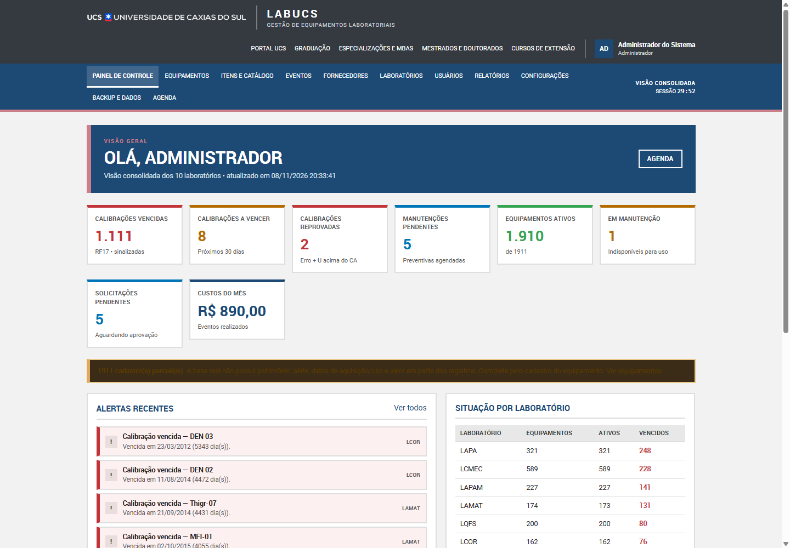

# 01 — Visão geral e arquitetura do LabUcs

**Sistema:** LabUcs — Gestão de Equipamentos Laboratoriais
**Instituição:** Universidade de Caxias do Sul — Campus CARVI
**Disciplina:** FBI4010X — Fundamentos de Engenharia de Software
**Equipe:** Cauã de Medeiros, Leonardo Bernardi, Rafaella Guimarães
**Natureza:** POC acadêmica, sem uso institucional.



---

## 1. Objetivo

O LabUcs substitui o controle em planilhas dos laboratórios da UCS por uma aplicação que registra equipamentos, calibrações, verificações, manutenções, fornecedores, custos e aprovações, com rastreabilidade e relatórios compatíveis com os anexos atuais.

A POC é **funcionalmente completa** para os RF01–RF17 e trata os RNF01–RNF15 no escopo de um site estático. Ela é publicada no GitHub Pages, sem servidor, banco remoto ou variáveis de ambiente.

## 2. Separação frontend/backend

```
index.html
src/
  shared/                  constantes, erros, utilidades e formatação comuns
  backend/                 regras de negócio (sem DOM)
    domain/                metrologia, prazos, sinais, permissões, LGPD
    application/           casos de uso em camadas coesas
      application-core.js  contexto, DTOs, auditoria e transações
      identity-application.js
      registry-application.js
      operations-application.js
      reporting-application.js
      settings-application.js
      application.js       composição + fachada de namespaces
    infrastructure/        IndexedDB, sessão/PBKDF2, semente
    reports/               construtores + CSV/XLSX/PDF
    api/                   `criarAplicacao()`
    index.js               API pública do backend
  frontend/                camada visual (UCS)
    main.js                boot, sessão, render
    router.js              rotas por hash
    layout.js              cabeçalho, navegação e rodapé UCS
    pages/                 uma página por domínio funcional
    components/            UI, formulários, tabelas e opções
    styles.css             identidade institucional
    assets/                logos e Roboto oficiais
```

**Regra de ouro:** o frontend não recalcula Erro+U, prazos, permissões ou relatórios. Ele consome a fachada `criarAplicacao()` e trata `ErroApp.campos`.

## 3. Identidade visual

A interface segue o portal institucional da UCS:

- **Roboto** como fonte (arquivos locais em `src/frontend/assets/`).
- Azul institucional da área de Exatas **#1d4975**; secundária **#cc7e89**.
- Cinza do cabeçalho/rodapé **#343a40**; fundos **#e8e8e8**; bordas de **2px #dedede**.
- Cantos retos, títulos e botões em caixa alta, tabelas com cabeçalho cinza.
- Logos oficiais UCS e FUCS no cabeçalho e no rodapé.
- Endereço, Central de Atendimento e copyright institucionais no rodapé.

## 4. Escopo funcional

| RF | Implementação |
| --- | --- |
| RF01 | Catálogo de funcionalidades por perfil; navegação oculta e API bloqueia |
| RF02 | Itens/modelos, categorias e subcategorias |
| RF03 | Equipamento com item, laboratório, patrimônio, TAG e série |
| RF04 | Consulta, filtros, edição e inativação lógica |
| RF05 | Inventário de ativos e divergências por evento |
| RF06 | Usuários, perfis exclusivos e permissões |
| RF07 | Laboratórios com sigla/código únicos |
| RF08 | Calibração com certificado, erro, U e CA |
| RF09 | Cálculo `|erro| + U ≤ CA` e prévia na tela |
| RF10 | Verificação com CA e periodicidade próprios |
| RF11 | Manutenção preventiva (recorrente) e corretiva (estado de retorno) |
| RF12 | Solicitação, aprovação/rejeição e segregação de funções |
| RF13 | Painel de alertas de vencimento e pendências |
| RF14 | Histórico com filtros e exportação PDF/Excel/CSV |
| RF15 | Custos por laboratório/tipo × receita mensal |
| RF16 | Fornecedores com CNPJ validado e situação |
| RF17 | Sinalização sem bloqueio automático |

Relatórios compatíveis com os anexos: ficha do equipamento (Anexo 1), manutenções corretivas (Anexo 2), status/histórico de calibrações (Anexo 4) e manutenções preventivas (Anexo 5).

## 5. Base real

| Indicador | Valor |
| --- | ---: |
| Laboratórios | 10 |
| Equipamentos | 1.911 |
| Itens/modelos | 823 |
| Com calibração registrada | 1.726 |
| Sem calibração registrada | 185 |
| Usuários | 22 |
| Eventos importados | 1.735 |

A importação é reprodutível por `npm run importar`; o relatório completo está em [RELATORIO-IMPORTACAO.md](../data/RELATORIO-IMPORTACAO.md).

**Lacunas transparentes:** a planilha não possui patrimônio, série, data/valor de aquisição e colocação em uso para a maior parte dos registros. Esses campos ficam nulos e aparecem como pendência; nada é inventado. O CA é derivado por categoria e marcado como estimado.

## 6. Persistência e segurança

- IndexedDB no navegador; fallback para localStorage/memória.
- Backup automático diário, backup manual, exportação/importação JSON e reinício da demonstração.
- Sessão em `sessionStorage`, timeout de inatividade de 30 minutos, PBKDF2-SHA256 com sal.
- RBAC por perfil e por laboratório; auditoria append-only consultável apenas pelo Gestor Geral.
- Nenhum dado é enviado a terceiros; não há telemetria.

## 7. Limitações declaradas

| Limitação | Efeito |
| --- | --- |
| Site estático | Sem autenticação server-side, sem IP real nem concorrência entre dispositivos |
| Dados locais | Limpar o navegador apaga os dados; usar exportação/backup |
| Base incompleta | Cadastros parciais e CA estimado a revisar |
| RNF06 | Disponibilidade delegada ao GitHub Pages, sem SLA próprio |
| PDF | Layout próprio, sem assinatura digital ou valor legal |
| RNF03 | IP registrado como `local (POC estático)` |

## 8. Documentos

- [02 — Modelo de dados](02-MODELO-DE-DADOS.md)
- [03 — Regras de negócio](03-REGRAS-DE-NEGOCIO.md)
- [04 — Contrato de serviços](04-API-DE-SERVICOS.md)
- [05 — Validação e testes](05-VALIDACAO-E-TESTES.md)
- [06 — Deploy no GitHub Pages](06-DEPLOY-GITHUB-PAGES.md)
- [07 — Rastreabilidade](07-MATRIZ-RASTREABILIDADE.md)
